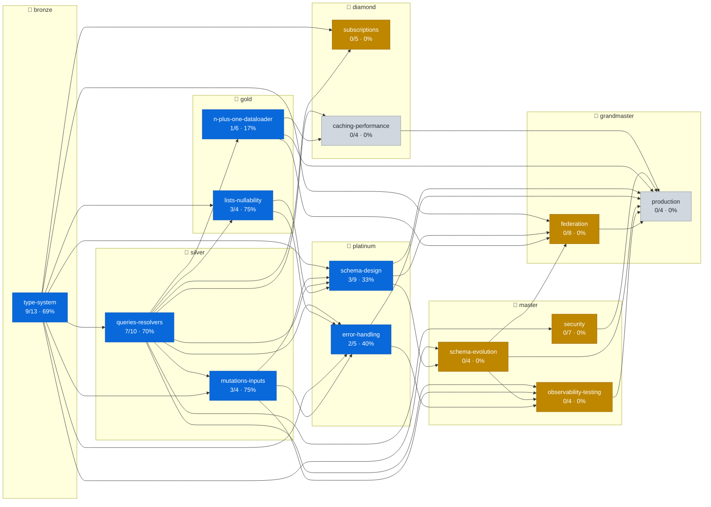

# Frontier map — GraphQL

> Auto-generated by `tools/frontier-map.mjs` from `graph.json` + `ledger.json`.
> Regenerate after every `/grade`: `node tools/frontier-map.mjs`. Last built **2026-11-05**.

**Rank: 🥈 silver** · 28/87 concepts mastered · 19 on the edge · 40 locked

Legend: `mastered` · `in progress` · `due for review` · `edge (unlocked)` · `locked`

## Rank progression

| Rank | Progress | Boss concept | Boss cleared |
|------|----------|--------------|:---:|
| 🥉 bronze | `████████████░░░░░░` 69% (9/13) | `the-schema-document` | ✅ |
| 🥈 silver | `█████████████░░░░░` 71% (10/14) | `mutation-payload-type` | ✅ |
| 🥇 gold | `███████░░░░░░░░░░░` 40% (4/10) | `dataloader-per-request` | — |
| 💠 platinum | `██████░░░░░░░░░░░░` 36% (5/14) | `relay-connections` | — |
| 💎 diamond | `░░░░░░░░░░░░░░░░░░` 0% (0/9) | `subscription-scaling` | — |
| 🧠 master | `░░░░░░░░░░░░░░░░░░` 0% (0/15) | `production-readiness` | — |
| 👑 grandmaster | `░░░░░░░░░░░░░░░░░░` 0% (0/12) | `distributed-graph-mastery` | — |

## Rank & module overview

## Per-module detail

| Module | Rank | Mastered | Edge | Locked |
|--------|------|:---:|:---:|:---:|
| type-system | 🥉 bronze | 9 | 4 | 0 |
| queries-resolvers | 🥈 silver | 7 | 2 | 1 |
| mutations-inputs | 🥈 silver | 3 | 1 | 0 |
| lists-nullability | 🥇 gold | 3 | 1 | 0 |
| n-plus-one-dataloader | 🥇 gold | 1 | 1 | 4 |
| schema-design | 💠 platinum | 3 | 3 | 3 |
| error-handling | 💠 platinum | 2 | 1 | 2 |
| subscriptions | 💎 diamond | 0 | 1 | 4 |
| caching-performance | 💎 diamond | 0 | 0 | 4 |
| security | 🧠 master | 0 | 2 | 5 |
| schema-evolution | 🧠 master | 0 | 1 | 3 |
| observability-testing | 🧠 master | 0 | 1 | 3 |
| federation | 👑 grandmaster | 0 | 1 | 7 |
| production | 👑 grandmaster | 0 | 0 | 4 |

## The full graph

★ marks a rank boss. Prerequisite edges only (the `encompasses` review-credit edges are omitted for legibility).

```mermaid
flowchart TD
  subgraph n_mod_type_system["🥉 type-system"]
    n_sdl_basics["sdl-basics"]:::mastered
    n_scalar_types["scalar-types"]:::mastered
    n_object_types["object-types"]:::mastered
    n_field_arguments["field-arguments"]:::mastered
    n_enum_types["enum-types"]:::edge
    n_list_types["list-types"]:::mastered
    n_non_null_types["non-null-types"]:::mastered
    n_input_object_types["input-object-types"]:::mastered
    n_interface_types["interface-types"]:::edge
    n_union_types["union-types"]:::edge
    n_custom_scalars["custom-scalars"]:::edge
    n_schema_root_types["schema-root-types"]:::mastered
    n_the_schema_document["★ the-schema-document"]:::mastered
  end
  subgraph n_mod_queries_resolvers["🥈 queries-resolvers"]
    n_query_operation["query-operation"]:::mastered
    n_resolver_signature["resolver-signature"]:::mastered
    n_resolver_map["resolver-map"]:::mastered
    n_default_resolvers["default-resolvers"]:::mastered
    n_resolver_chain["resolver-chain"]:::mastered
    n_context_object["context-object"]:::mastered
    n_variables["variables"]:::mastered
    n_aliases_fragments["aliases-fragments"]:::locked
    n_info_argument["info-argument"]:::edge
    n_apollo_server_setup["apollo-server-setup"]:::edge
  end
  subgraph n_mod_mutations_inputs["🥈 mutations-inputs"]
    n_mutation_operation["mutation-operation"]:::mastered
    n_mutation_input_arg["mutation-input-arg"]:::mastered
    n_mutation_payload_type["★ mutation-payload-type"]:::mastered
    n_mutation_side_effects["mutation-side-effects"]:::edge
  end
  subgraph n_mod_lists_nullability["🥇 lists-nullability"]
    n_nullability_semantics["nullability-semantics"]:::mastered
    n_null_propagation["null-propagation"]:::mastered
    n_list_nullability["list-nullability"]:::edge
    n_partial_results["partial-results"]:::mastered
  end
  subgraph n_mod_n_plus_one_dataloader["🥇 n-plus-one-dataloader"]
    n_n_plus_one_problem["n-plus-one-problem"]:::mastered
    n_dataloader_batching["dataloader-batching"]:::edge
    n_dataloader_caching["dataloader-caching"]:::locked
    n_dataloader_per_request["★ dataloader-per-request"]:::locked
    n_batch_ordering["batch-ordering"]:::locked
    n_lookahead_optimization["lookahead-optimization"]:::locked
  end
  subgraph n_mod_schema_design["💠 schema-design"]
    n_client_driven_design["client-driven-design"]:::edge
    n_naming_conventions["naming-conventions"]:::edge
    n_relationships_modeling["relationships-modeling"]:::mastered
    n_offset_pagination["offset-pagination"]:::mastered
    n_cursor_pagination["cursor-pagination"]:::mastered
    n_relay_connections["★ relay-connections"]:::locked
    n_abstract_type_design["abstract-type-design"]:::locked
    n_global_object_identification["global-object-identification"]:::locked
    n_input_design["input-design"]:::edge
  end
  subgraph n_mod_error_handling["💠 error-handling"]
    n_errors_array["errors-array"]:::mastered
    n_error_extensions["error-extensions"]:::edge
    n_typed_errors_union["typed-errors-union"]:::locked
    n_user_errors_payload["user-errors-payload"]:::mastered
    n_error_boundaries["error-boundaries"]:::locked
  end
  subgraph n_mod_subscriptions["💎 subscriptions"]
    n_subscription_operation["subscription-operation"]:::edge
    n_subscription_resolver["subscription-resolver"]:::locked
    n_pubsub_mechanics["pubsub-mechanics"]:::locked
    n_graphql_ws_protocol["graphql-ws-protocol"]:::locked
    n_subscription_scaling["★ subscription-scaling"]:::locked
  end
  subgraph n_mod_caching_performance["💎 caching-performance"]
    n_response_caching["response-caching"]:::locked
    n_cache_hints["cache-hints"]:::locked
    n_automatic_persisted_queries["automatic-persisted-queries"]:::locked
    n_field_level_caching["field-level-caching"]:::locked
  end
  subgraph n_mod_security["🧠 security"]
    n_auth_context["auth-context"]:::edge
    n_field_authorization["field-authorization"]:::locked
    n_depth_limiting["depth-limiting"]:::edge
    n_complexity_analysis["complexity-analysis"]:::locked
    n_introspection_control["introspection-control"]:::locked
    n_rate_limiting_batching_abuse["rate-limiting-batching-abuse"]:::locked
    n_persisted_trusted_documents["persisted-trusted-documents"]:::locked
  end
  subgraph n_mod_schema_evolution["🧠 schema-evolution"]
    n_deprecation["deprecation"]:::edge
    n_additive_changes["additive-changes"]:::locked
    n_breaking_change_detection["breaking-change-detection"]:::locked
    n_versionless_api["versionless-api"]:::locked
  end
  subgraph n_mod_observability_testing["🧠 observability-testing"]
    n_resolver_testing["resolver-testing"]:::edge
    n_schema_testing["schema-testing"]:::locked
    n_tracing_metrics["tracing-metrics"]:::locked
    n_error_monitoring["error-monitoring"]:::locked
  end
  subgraph n_mod_federation["👑 federation"]
    n_federation_intro["federation-intro"]:::edge
    n_subgraph_schema["subgraph-schema"]:::locked
    n_entity_keys["entity-keys"]:::locked
    n_reference_resolvers["reference-resolvers"]:::locked
    n_shareable_external["shareable-external"]:::locked
    n_requires_provides["requires-provides"]:::locked
    n_supergraph_composition["supergraph-composition"]:::locked
    n_router_query_planning["router-query-planning"]:::locked
  end
  subgraph n_mod_production["👑 production"]
    n_performance_budget["performance-budget"]:::locked
    n_api_design_review["api-design-review"]:::locked
    n_production_readiness["★ production-readiness"]:::locked
    n_distributed_graph_mastery["★ distributed-graph-mastery"]:::locked
  end
  n_sdl_basics --> n_scalar_types
  n_sdl_basics --> n_object_types
  n_scalar_types --> n_object_types
  n_object_types --> n_field_arguments
  n_object_types --> n_enum_types
  n_object_types --> n_list_types
  n_object_types --> n_non_null_types
  n_object_types --> n_input_object_types
  n_field_arguments --> n_input_object_types
  n_object_types --> n_interface_types
  n_object_types --> n_union_types
  n_scalar_types --> n_custom_scalars
  n_object_types --> n_schema_root_types
  n_object_types --> n_the_schema_document
  n_schema_root_types --> n_the_schema_document
  n_non_null_types --> n_the_schema_document
  n_list_types --> n_the_schema_document
  n_the_schema_document --> n_query_operation
  n_schema_root_types --> n_resolver_signature
  n_field_arguments --> n_resolver_signature
  n_resolver_signature --> n_resolver_map
  n_the_schema_document --> n_resolver_map
  n_resolver_map --> n_default_resolvers
  n_resolver_map --> n_resolver_chain
  n_default_resolvers --> n_resolver_chain
  n_resolver_signature --> n_context_object
  n_query_operation --> n_variables
  n_field_arguments --> n_variables
  n_query_operation --> n_aliases_fragments
  n_interface_types --> n_aliases_fragments
  n_resolver_signature --> n_info_argument
  n_resolver_map --> n_apollo_server_setup
  n_query_operation --> n_mutation_operation
  n_resolver_map --> n_mutation_operation
  n_mutation_operation --> n_mutation_input_arg
  n_input_object_types --> n_mutation_input_arg
  n_mutation_operation --> n_mutation_payload_type
  n_object_types --> n_mutation_payload_type
  n_mutation_operation --> n_mutation_side_effects
  n_non_null_types --> n_nullability_semantics
  n_resolver_chain --> n_nullability_semantics
  n_nullability_semantics --> n_null_propagation
  n_list_types --> n_list_nullability
  n_nullability_semantics --> n_list_nullability
  n_null_propagation --> n_partial_results
  n_resolver_chain --> n_n_plus_one_problem
  n_n_plus_one_problem --> n_dataloader_batching
  n_context_object --> n_dataloader_batching
  n_dataloader_batching --> n_dataloader_caching
  n_dataloader_batching --> n_dataloader_per_request
  n_context_object --> n_dataloader_per_request
  n_dataloader_batching --> n_batch_ordering
  n_info_argument --> n_lookahead_optimization
  n_n_plus_one_problem --> n_lookahead_optimization
  n_the_schema_document --> n_client_driven_design
  n_mutation_payload_type --> n_client_driven_design
  n_the_schema_document --> n_naming_conventions
  n_object_types --> n_relationships_modeling
  n_resolver_chain --> n_relationships_modeling
  n_field_arguments --> n_offset_pagination
  n_list_types --> n_offset_pagination
  n_offset_pagination --> n_cursor_pagination
  n_cursor_pagination --> n_relay_connections
  n_interface_types --> n_relay_connections
  n_interface_types --> n_abstract_type_design
  n_union_types --> n_abstract_type_design
  n_relay_connections --> n_global_object_identification
  n_interface_types --> n_global_object_identification
  n_input_object_types --> n_input_design
  n_nullability_semantics --> n_input_design
  n_resolver_map --> n_errors_array
  n_null_propagation --> n_errors_array
  n_errors_array --> n_error_extensions
  n_union_types --> n_typed_errors_union
  n_errors_array --> n_typed_errors_union
  n_mutation_payload_type --> n_typed_errors_union
  n_mutation_payload_type --> n_user_errors_payload
  n_errors_array --> n_user_errors_payload
  n_typed_errors_union --> n_error_boundaries
  n_user_errors_payload --> n_error_boundaries
  n_the_schema_document --> n_subscription_operation
  n_resolver_map --> n_subscription_operation
  n_subscription_operation --> n_subscription_resolver
  n_context_object --> n_subscription_resolver
  n_subscription_resolver --> n_pubsub_mechanics
  n_subscription_operation --> n_graphql_ws_protocol
  n_apollo_server_setup --> n_graphql_ws_protocol
  n_pubsub_mechanics --> n_subscription_scaling
  n_graphql_ws_protocol --> n_subscription_scaling
  n_context_object --> n_auth_context
  n_auth_context --> n_field_authorization
  n_resolver_chain --> n_field_authorization
  n_query_operation --> n_depth_limiting
  n_resolver_chain --> n_depth_limiting
  n_depth_limiting --> n_complexity_analysis
  n_apollo_server_setup --> n_introspection_control
  n_complexity_analysis --> n_rate_limiting_batching_abuse
  n_apollo_server_setup --> n_persisted_trusted_documents
  n_complexity_analysis --> n_persisted_trusted_documents
  n_apollo_server_setup --> n_response_caching
  n_resolver_chain --> n_response_caching
  n_response_caching --> n_cache_hints
  n_apollo_server_setup --> n_automatic_persisted_queries
  n_dataloader_caching --> n_field_level_caching
  n_response_caching --> n_field_level_caching
  n_the_schema_document --> n_deprecation
  n_deprecation --> n_additive_changes
  n_client_driven_design --> n_additive_changes
  n_additive_changes --> n_breaking_change_detection
  n_additive_changes --> n_versionless_api
  n_the_schema_document --> n_federation_intro
  n_relationships_modeling --> n_federation_intro
  n_federation_intro --> n_subgraph_schema
  n_subgraph_schema --> n_entity_keys
  n_entity_keys --> n_reference_resolvers
  n_dataloader_batching --> n_reference_resolvers
  n_entity_keys --> n_shareable_external
  n_reference_resolvers --> n_requires_provides
  n_shareable_external --> n_requires_provides
  n_entity_keys --> n_supergraph_composition
  n_breaking_change_detection --> n_supergraph_composition
  n_supergraph_composition --> n_router_query_planning
  n_reference_resolvers --> n_router_query_planning
  n_resolver_map --> n_resolver_testing
  n_mutation_operation --> n_resolver_testing
  n_resolver_testing --> n_schema_testing
  n_breaking_change_detection --> n_schema_testing
  n_resolver_chain --> n_tracing_metrics
  n_apollo_server_setup --> n_tracing_metrics
  n_error_extensions --> n_error_monitoring
  n_tracing_metrics --> n_error_monitoring
  n_field_level_caching --> n_performance_budget
  n_complexity_analysis --> n_performance_budget
  n_lookahead_optimization --> n_performance_budget
  n_client_driven_design --> n_api_design_review
  n_relay_connections --> n_api_design_review
  n_error_boundaries --> n_api_design_review
  n_versionless_api --> n_api_design_review
  n_field_authorization --> n_production_readiness
  n_persisted_trusted_documents --> n_production_readiness
  n_error_monitoring --> n_production_readiness
  n_breaking_change_detection --> n_production_readiness
  n_router_query_planning --> n_distributed_graph_mastery
  n_production_readiness --> n_distributed_graph_mastery
  n_performance_budget --> n_distributed_graph_mastery
  classDef mastered fill:#1a7f37,stroke:#116329,color:#ffffff,stroke-width:1px;
  classDef progress fill:#0969da,stroke:#0a53be,color:#ffffff,stroke-width:1px;
  classDef due fill:#cf222e,stroke:#a40e26,color:#ffffff,stroke-width:1px;
  classDef edge fill:#bf8700,stroke:#9a6700,color:#ffffff,stroke-width:1px;
  classDef locked fill:#d0d7de,stroke:#8c959f,color:#24292f,stroke-width:1px;
```

Expand the full concept DAG (87 concepts)

## On the edge now

Unlocked and waiting — `/next` picks from here:

- `enum-types` (type-system, fluency, difficulty 3)
- `interface-types` (type-system, fluency, difficulty 5)
- `union-types` (type-system, fluency, difficulty 5)
- `custom-scalars` (type-system, judgment, difficulty 5)
- `apollo-server-setup` (queries-resolvers, fluency, difficulty 3)
- `info-argument` (queries-resolvers, judgment, difficulty 6)
- `mutation-side-effects` (mutations-inputs, judgment, difficulty 6)
- `list-nullability` (lists-nullability, judgment, difficulty 6)
- `dataloader-batching` (n-plus-one-dataloader, fluency, difficulty 6)
- `naming-conventions` (schema-design, judgment, difficulty 4)
- `client-driven-design` (schema-design, judgment, difficulty 6)
- `input-design` (schema-design, judgment, difficulty 6)
- `error-extensions` (error-handling, judgment, difficulty 6)
- `subscription-operation` (subscriptions, fluency, difficulty 5)
- `deprecation` (schema-evolution, fluency, difficulty 4)
- `resolver-testing` (observability-testing, fluency, difficulty 5)
- `depth-limiting` (security, judgment, difficulty 6)
- `auth-context` (security, judgment, difficulty 6)
- `federation-intro` (federation, judgment, difficulty 6)
